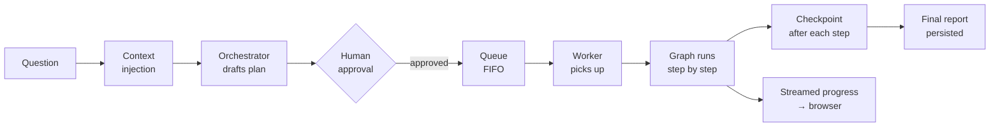

# Chapter 1 · Problem, design, and implementation plan

Start with the problem, not the framework.

A user asks a business question. The system should produce a sourced research report. Before it calls expensive tools, a human should see and approve the plan. The work may take forty minutes. The browser may disconnect. A worker may crash halfway through. A second worker should resume without duplicating the report.

That is the system we are building in this series.

The agent inside it is a **deep agent**: one that drafts a multi-step plan, waits for a human to approve it, then carries it out over many tool calls and many minutes. Its working state lives in a database, not in one process, so the run can pause and resume. The contrast case is a one-pass agent that calls a tool once and answers, which this series calls reactive mode ([Step 8a](step-8a-reactive-mode-prompt.md)).

The whole system is a **distributed system with an agent inside it**. A chatbot or an API handler that calls a model and returns never has to survive a crash halfway through a forty-minute job.

## The problem

A crash is the easy failure, because you can see it. The dangerous one looks like this:

```text
HTTP request: 200 OK
Logs:         normal
User sees:    plausible report
Reality:      wrong country, duplicated work, stale context, or invented number
```

This is the distinction the whole series turns on:

```text
Transport success:
  the request finished

Semantic success:
  the right context, state, plan, lock, persistence, and provenance rules held
```

An ordinary API often lets you treat those as the same thing. A production deep agent does not.

## The design decisions

The implementation follows six decisions. Each later chapter turns one of them into code.

1. **Make state durable.** The run must survive a different request, worker, or deploy.
2. **Inject context at a controlled boundary.** The model needs user and business context, but stale context must not leak into later phases.
3. **Plan before execution.** The model drafts an inspectable plan, and a human approves it before expensive work begins.
4. **Name every moving part.** A thread, plan, interrupt, run attempt, stream event, lock tenure, and retrieved fact are not the same thing.
5. **Separate progress from truth.** SSE is for narration. Checkpoints and run-state are the durable source of truth.
6. **Use code for boundaries and prompts for judgment.** Code enforces approval, tools, locks, and ownership. The prompt shapes planning, grounding, and reasoning order.

## The implementation plan

We will build the system in this order:

```text
Chapter 2   End-to-end architecture and orchestrator flow
Step 1      State and checkpoints
Step 2      Context injection
Step 3      Planning and human approval
Step 4      Identifiers
Step 5      Streaming and background work
Bridge      DynamoDB conditional writes and SQS
Step 6      Distributed locks
Step 7      Queue and worker execution (7a: the event feed)
Step 8      Orchestrator prompt (8a to 8e: reactive mode, clarifications,
            plan lifecycle, carryover, code layout)
Capstones   Nine silent failures; when the score passes
```
Identifiers make more sense after you have seen a plan pause and resume. Locks make more sense after the browser can double-click approval. Prompt design makes more sense after code already owns the boundaries.

## The lifecycle of a single run

Here is the full system we are going to build:



Here is what happens at each stage and what can go wrong at each boundary.

**Question.** The user's intent arrives as text. It is not yet enough to act on. The agent also needs to know who the user is, what they are permitted to see, and what defaults apply to their account.

**Context injection.** Before any model call, the system attaches what the model cannot derive from the message alone: account context, user permissions, locale, relevant business rules. The system has to keep "what the user typed" and "what the system added" apart on purpose. [Step 2](step-2-context-injection.md) covers this.

**Orchestrator drafts a plan.** The model reads the enriched question and produces a structured sequence of steps a human can read and evaluate: "query this source, verify that figure, draft this section" instead of "do research." [Step 3](step-3-planning-and-human-approval.md) covers this together with approval.

**Human approval.** The plan pauses at a gate. A human reads it and approves or rejects it. Only after approval does any expensive execution begin. This single gate means the run spans two or more HTTP requests, not one. [Step 3](step-3-planning-and-human-approval.md) covers this.

**Queue.** The approved plan is handed to a FIFO queue, keyed on the conversation thread. The API process returns immediately; the queue holds the intent durably until a worker is ready. [Step 7](step-7-queue-and-worker-execution.md) covers this.

**Worker.** A background worker dequeues the job and begins executing the plan. The worker is independent of the API process. It may run on a different machine, across a deploy boundary, or restart after a crash without the user knowing anything changed. [Step 7](step-7-queue-and-worker-execution.md) covers this.

**Graph runs step by step.** The worker runs the plan as a LangGraph graph, one node per step. Each node reads from state, does its work, and writes results back. [Step 1](step-1-state-and-checkpoints.md) covers how that state works.

**Checkpoint after each step.** After every node, LangGraph persists a checkpoint: a complete snapshot of state at that point. If the worker crashes at step 4, a new worker reads the checkpoint and resumes from step 4 instead of starting over. [Step 1](step-1-state-and-checkpoints.md) covers checkpoints.

**Streamed progress → browser.** As the graph runs, it emits progress events over SSE (server-sent events). The browser shows the report being built section by section. The SSE connection is ephemeral, and closing the browser must not stop the work. [Step 5](step-5-streaming-and-background-work.md) covers this.

**Final report persisted.** When the graph completes, the finished report is written to durable storage. The user can reload, share the link, or return a week later.

## What makes this a distributed system

Each stage of the lifecycle runs in a different context:

- The **API process** handles the question and the approval.
- The **queue** holds intent across process boundaries.
- The **worker** executes the plan.
- The **checkpoint store** persists state across crashes and deploys.
- The **SSE stream** connects the browser to live progress without keeping the work alive.

The standard tutorial loop (call model, run tool, return answer) never shows this. When work must outlive the request that started it, you are no longer writing a request handler. You are operating a small distributed system, and every boundary between those components is a place where state can be lost, duplicated, or corrupted while every individual component still reports success.

The rest of this series covers how to prevent the `200 OK`, wrong-answer failure at each of those boundaries.

## Terms you'll meet

Chapter 2 uses these words before the steps that teach them. One sentence each is enough to keep reading. Each links to its glossary entry and names the page that teaches it properly.

- **[Deep agent](glossary.md#deep-agent).** An agent that plans, pauses for approval, then executes over many steps with its state in a database. Defined above.
- **[Checkpoint](glossary.md#checkpoint).** The saved copy of the graph's state after each step. Any process can reload it and continue the run. Taught in [Step 1](step-1-state-and-checkpoints.md).
- **[Interrupt](glossary.md#interrupt).** The `interrupt()` call that pauses the graph to wait for a human. The pause is written into the checkpoint, so the HTTP request can end. Taught in [Step 3](step-3-planning-and-human-approval.md).
- **[SQS FIFO queue](glossary.md#fifo-queue).** An AWS queue that will not hand out a second message for a conversation while the first is still being worked on. That gives one worker per conversation. Introduced in the [DynamoDB and SQS bridge](bridge-dynamodb-and-sqs.md), used in [Step 7](step-7-queue-and-worker-execution.md).
- **[DynamoDB](glossary.md#dynamodb-terms) and [conditional write](glossary.md#conditional-write).** DynamoDB is the AWS database that holds checkpoints, run-state, locks and events. A conditional write succeeds only if a condition is true at that instant, so two racing writers get exactly one winner. Introduced in the bridge, used for locks in [Step 6](step-6-distributed-locks.md).
- **[Worker](glossary.md#worker).** A background process that takes an approved run off the queue and executes it, separate from the API process that handled the request. Taught in [Step 7](step-7-queue-and-worker-execution.md).
- **[Carryover](glossary.md#carryover).** Reusing what an earlier turn already resolved or retrieved, instead of asking or querying again. Taught in [Step 8d](step-8d-carryover-and-data-manifest.md).
- **[Data manifest](glossary.md#data-manifest).** A short index of the results the agent already holds, shown to the model in place of the data itself. Taught in [Step 8d](step-8d-carryover-and-data-manifest.md).

---

!!! check "You should now understand"
    - The production problem this series solves
    - Why a deep agent is a distributed system with an agent inside it
    - The design decisions that shape the implementation
    - The step-by-step build plan for the rest of the chapters
    - Why `200 OK` and "the work was correct" are not the same thing

??? question "Try this"
    **Your team builds a request handler that calls an LLM, lets it pick tools, and returns the result, all in one HTTP request. They want to add human approval before any expensive tool runs. A colleague says: "Easy, just interrupt the function, wait for the approval callback, then resume." What breaks with that design, and what has to change?**

    ??? success "Answer"
        The approval can take minutes or days, because a human reads and approves asynchronously. Holding an HTTP connection open that long is not possible in practice (timeouts, load balancers, client disconnects). Approval changes the system topology: the first request produces the plan and returns; the human approves out-of-band; a second request resumes the run. This requires (1) durable checkpointed state so any replica can pick up the run, (2) a pause mechanism (`interrupt()`) that serializes the graph to storage rather than blocking a thread, and (3) a separate resume endpoint that delivers the human's decision. The single-function model doesn't survive crossing an HTTP boundary.

*Next: [Chapter 2 · End-to-end architecture and orchestrator flow](ch2-architecture-and-flow.md) — the whole production path before we zoom into each mechanism.*
